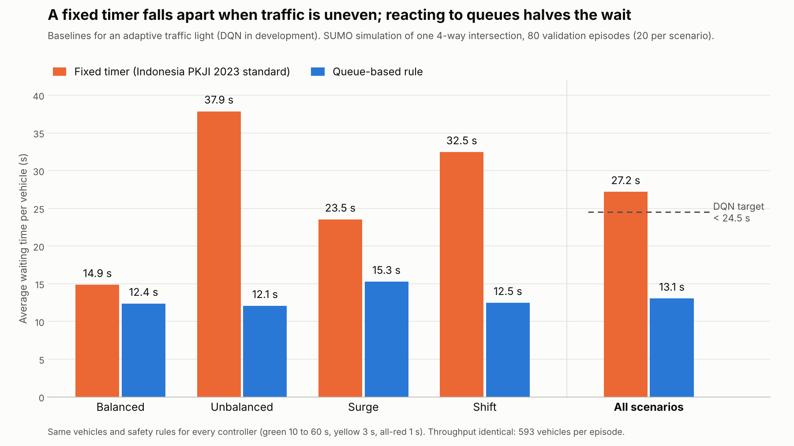

# Adaptive Traffic Light Control with Deep Reinforcement Learning

**Can an AI traffic light beat Indonesia's own official timing standard?**

A DQN controller for a simulated 4-way intersection in [SUMO](https://eclipse.dev/sumo/), tested against a fixed timer designed with Indonesia's road capacity manual (PKJI 2023) and a simple queue-based rule. Deep Learning final project (COMP6826001), BINUS University.

> **Status: in progress.** Simulator, scenarios and baselines are done. The Gymnasium environment and DQN training are next.



## Baseline results (validation, 80 episodes)

| Controller | How it works | Avg wait | Max wait | Avg queue |
|---|---|---|---|---|
| Fixed timer, PKJI 2023 | Green 15/17 s, 40 s cycle, designed with the official PKJI 2023 procedure | 27.2 s | 124 s | 8.0 |
| Queue rule | After minimum green, switch when the red side's queue is longer by more than 1 vehicle | **13.1 s** | 78 s | 4.0 |
| **DQN (target)** | Keep or switch every 5 s, learned from simulation | **< 24.5 s** (10% better than PKJI) | | |

Average wait per scenario:

| Scenario | PKJI fixed timer | Queue rule |
|---|---|---|
| Balanced | 14.9 s | 12.4 s |
| Unbalanced | 37.9 s | 12.1 s |
| Surge | 23.5 s | 15.3 s |
| Shift | 32.5 s | 12.5 s |

**Findings so far**
- The fixed timer can't adapt: on unbalanced traffic its wait triples, while the queue rule stays flat. This is where an adaptive controller should help.
- The queue rule is 52% better than PKJI, so it is kept as a second baseline. If the DQN only beats PKJI, the gain comes from reacting to queues, not from learning.
- SUMO's measured saturation flow (931 veh/h of green with mixed turns) is about half what PKJI predicts (1,798 pcu/h). PKJI itself notes that Indonesian drivers turn more aggressively than the gap-acceptance model SUMO uses, so results apply to the simulator only.

Full analysis (Indonesian): [`docs/findings_baselines_pkji.md`](docs/findings_baselines_pkji.md). Per-episode data: [`results/eval/`](results/eval/).

## Setup

| Item | Value |
|---|---|
| Intersection | One 4-way junction, 200 m arms, 1 lane per direction, 50 km/h |
| Driving side | Left-hand traffic (Indonesia), straight, left and right turns from every approach |
| Phases | NS green, EW green; yellow 3 s and all-red 1 s between |
| Safety rules (all controllers) | Green 10 to 60 s, transitions can't be cut short, every intervention logged |
| Episode | 1,800 s of arrivals plus up to 600 s clearance |
| Scenarios | balanced, unbalanced, surge, shift, plus a held-out stress test |
| Seeds | train 0 to 59, validation 60 to 79, test 80 to 99, fixed before any tuning ([`configs/splits.json`](configs/splits.json)) |
| Metrics | Avg and max wait, queue length, throughput, unserved vehicles |

## Folder layout

| Folder | Contents |
|---|---|
| `sumo/network/` | Intersection source files and the built `.net.xml` |
| `sumo/routes/` | Demand files; generated per-seed files are rebuilt with `scripts/generate_scenarios.py` |
| `src/traffic_rl/` | Python package: signal manager with safety rules, controllers, metrics, scenarios, evaluation |
| `scripts/` | Entry points: build network, generate scenarios, run episode, measure saturation, design timers, tune, evaluate |
| `configs/` | Seed split, PKJI factors with page references, timer designs, queue rule |
| `results/eval/` | Baseline evaluation results (per episode and aggregate) |
| `docs/` | Project plan, week 1-2 recap, baseline findings, chart |
| `models/`, `web/`, `report/`, `notebooks/` | DQN checkpoints, replay web app, final report (coming) |

## How to run (Windows)

```powershell
python -m venv .venv
.\.venv\Scripts\Activate.ps1
pip install -r requirements.txt     # SUMO comes from the eclipse-sumo pip package

python scripts\build_network.py
python scripts\generate_scenarios.py
python scripts\evaluate.py --controller fixed_pkji
python scripts\evaluate.py --controller queue_rule
python scripts\run_episode.py --scenario unbalanced --seed 60 --controller fixed_pkji --gui
```

## Roadmap

- [x] Simulator, intersection and logging
- [x] Scenario generator (420 seeded route files) and train/validation/test split
- [x] Baselines: PKJI 2023 fixed timer and queue rule
- [ ] Gymnasium environment
- [ ] DQN training and tuning on validation
- [ ] Final evaluation on the locked test split, including the stress scenario
- [ ] Web app with side-by-side replay

## References

- Direktorat Jenderal Bina Marga (2023). *Pedoman Kapasitas Jalan Indonesia* (No. 09/P/BM/2023).
- Webster, F. V. (1958). *Traffic signal settings*. Road Research Technical Paper No. 39.
- Lopez, P. A. et al. (2018). Microscopic Traffic Simulation using SUMO. *IEEE ITSC*.
